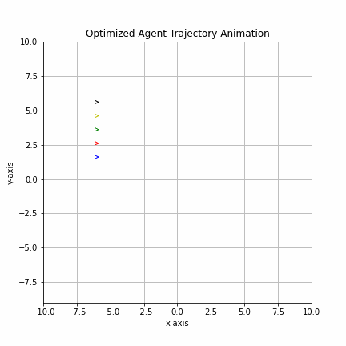

# Crazyflie Cyclic Pursuit

Research code for multi-agent cyclic pursuit with **Crazyflie 2.1** quadcopters. The project explores circular formations and motion relative to a moving reference point, from Python simulation to a ROS 2 / Crazyswarm2 controller prototype.



## Project components

| Component | What it contains |
| --- | --- |
| [Simulation](simulation/) | Jupyter notebooks for the cyclic pursuit controller, parameter tuning, and trajectory visualizations |
| [ROS 2 controller](ros2_ws/) | Custom `cyclic_pursuit` ROS 2 package migrated from the historical `ros2_isaac` branch |
| [Analysis](analysis/) | MATLAB script for trajectory, heading, and inter-agent distance analysis |
| [Documentation](docs/wsl2-tutorial.md) | Crazyradio USB passthrough to WSL2 |

## Python simulation

1. Install Python 3 and the notebook dependencies:
   ```bash
   python -m pip install jupyterlab numpy scipy matplotlib pandas tqdm pillow
   ```
2. From the repository root, open Jupyter:
   ```bash
   python -m jupyterlab
   ```
3. Run [`simulation/cyclic.ipynb`](simulation/cyclic.ipynb) top to bottom. See [`simulation/tuning_params.ipynb`](simulation/tuning_params.ipynb) for example parameter sets.

The notebook demonstrates agent trajectories, convergence and pairwise-distance plots, and an optional animation generator. An example GIF is in [`media/moving_centroid.gif`](media/moving_centroid.gif).

**Note:** In the documentation branch's default five-agent example, the constraint checker reported an unmet first geometric constraint even though the numerical solver completed. Review parameter validity before treating any trajectory as a validated safe formation.

## ROS 2 controller

The [ROS 2 workspace instructions](ros2_ws/README.md) describe the source package, external Crazyswarm2 dependency, and build/launch entry points. This is **historical research code brought into one place for review**, not a verified ready-to-fly release. Inspect the configuration, parameter handling, landing logic, and hardware safety assumptions before executing on real drones.

## MATLAB analysis

[`analysis/cyclic_pursuit_result_analysis.m`](analysis/cyclic_pursuit_result_analysis.m) contains trajectory, heading, and pairwise-distance plotting. It refers to historical rosbag file names. Large recorded `.db3` files were intentionally not copied into this branch.

## Hardware and WSL2

See the [Crazyradio USB / WSL2 guide](docs/wsl2-tutorial.md). No internal Wi-Fi passwords or hardware credentials are included in this consolidated documentation.

## Project history and attribution

This consolidation preserves the original simulation notebooks and the custom ROS 2 / MATLAB source from earlier repository branches. The original main-branch README credits **Sudhanshu Shankar and Isaac Lin**. The ROS 2 package remains in its original experimental state, and any upstream Crazyswarm2 components retain their own licenses in the upstream project.

## Reference

[Collective circular motion of multi-vehicle systems](https://www.sciencedirect.com/science/article/pii/S0005109808002951).
