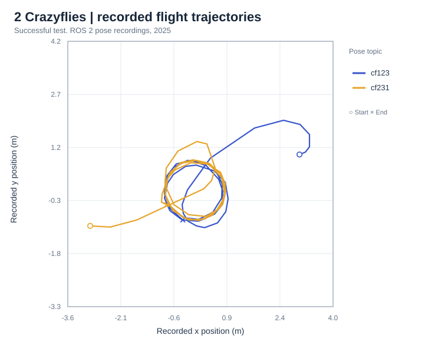
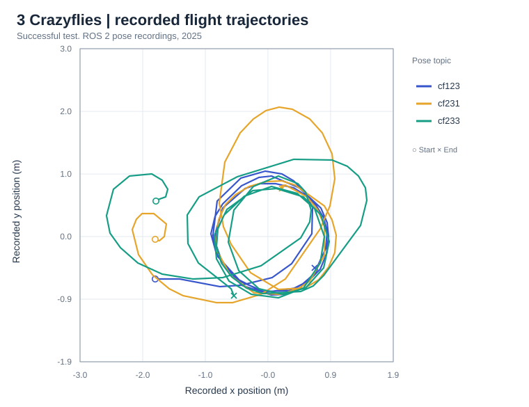

# Physical Crazyflie experiments: results from recorded flights

**Historical tests:** September 2024 to May 2025, MURO Lab, UC San Diego.  
**Platform:** Crazyflie drones · ROS 2 · Crazyswarm2 · OptiTrack motion capture.  
**Status:** Archive of experimental evidence, **not** a verified flight-ready controller.

In my May 2025 final report, I documented my implementation of the
multi-agent cyclic pursuit controller based on Ceccarelli *et al.* and
my physical tests with two, three, and four Crazyflies. I **successfully
demonstrated circular pursuit with two and three physical drones**.
The four-drone test was **unsuccessful**: I observed an unexpected
mid-flight flip and substantial deviations from the simulated trajectories.
I was unable to isolate the root cause. These success/failure labels
reflect my experiment report and original recording labels, not conclusions
inferred solely from the plotted paths.

These flights occurred **before** the 2026 cloud-based ROS 2 simulation
and 100-seed numerical evaluation. They demonstrate real hardware integration
but must not be confused with a guarantee of collision avoidance or with
the results of the newer idealized experiments.

## Recorded trajectories

The plots below are **simplified SVG redrawings from the supplied ROS 2
pose recordings**, not copies of the original MATLAB JPEGs. They retain the
chronological pose paths, with line simplification for readability; **use the
quantitative values and original bags for distances, not the illustrations**.
Each ○ denotes a recorded start and × a recorded endpoint.

### Two Crazyflies — successful trial

The flight exhibited repeated orbital motion after the initial approach.
The available bag includes **two pose topics and two command topics**.
This is a successful circular-pursuit demonstration as documented by the
original team, but the minimum estimated separation in the recording was
only **0.164 m**, below the project's 0.5 m practical guideline.

### Three Crazyflies — successful trial

The recorded paths show repeated motion around a common region. The final
report describes successful approximate circular pursuit in the three-agent
flight, but notes that the experimental equilibrium radius appeared to
differ from the simulation. The supplied bag contains **three pose
topics**, but **no command topics**; the controller commands for this run
cannot be reconstructed from these recordings alone.

### Four Crazyflies — unsuccessful trial

The four-drone paths are irregular. The final report describes a robot
flipping during the trial, which affected the rest of the formation. Possible
contributors discussed in the report include flight-controller/firmware
problems and packet loss as swarm size increased. **These are hypotheses,
not confirmed root causes.** This bag contains **four pose topics**
and no recorded controller command topics.

## Measurements from the recorded ROS 2 bags

| Flight recording | Common pose-recording interval | Pose topics | Command topics | Estimated minimum 3-D separation over full recording | Estimated minimum while all drones had z > 0.35 m |
| --- | ---: | ---: | ---: | ---: | ---: |
| Two-drone success | 88.06 s | 2 | 2 | **0.164 m** | **0.164 m** |
| Three-drone success | 104.84 s | 3 | 0 | **0.489 m** | **0.586 m** |
| Four-drone failure | 106.45 s | 4 | 0 | **0.105 m** | **0.108 m** |

These values were computed from the supplied ROS 2 SQLite `.db3` bags.
For every recorded pose topic, positions were linearly interpolated to a
**common 20 Hz timestamp grid**. Euclidean pairwise separation was
computed using all three positional coordinates `x, y, z`. The reported
minimum is the smallest value across all pairs over that interval.

The second minimum restricts samples to times when **every participating
robot had recorded `pose.position.z > 0.35 m`**. This threshold is an
analysis convention, not a confirmed takeoff/landing classification. Full
recordings may include initialization, takeoff, landing, or tracking artifacts.
Interpolation and timestamp alignment also introduce uncertainty.

In my original report, I used **0.5 m** as a practical minimum-separation
guideline, not as a universal collision threshold.
The low estimated separation in the otherwise successful two-drone test
shows why successful orbiting and safe clearance are **different claims**.
These values **do not establish that any physical collision occurred**.

A compact machine-readable copy of the table is available at
[real-flight-summary.csv](real-flight-summary.csv).

## Experimental architecture and contributions

I built the ROS 2 cyclic pursuit package so that each Crazyflie could
run its controller as a separate node, using Crazyswarm2, Crazyradio
communication, and OptiTrack pose measurements. My work included
implementing the missing inter-agent interaction term, developing and
testing the Python simulation, writing MATLAB scripts for trajectory and
distance analysis, tuning the gains for our test area, and conducting
the physical flight experiments.

I built on **Sudhanshu Shankar's** earlier beacon-controller script
and basic simulator. **Scott Addams and Arnau Marzabal** helped with
the Crazyflie hardware and OptiTrack setup. This was a collaborative
MURO Lab project, and I want to credit that support while making my own
technical contributions clear.

The report describes the following experiment-specific limitations:

- **Initial heading and tracking:** Single-marker OptiTrack tracking
  required a prescribed initial drone orientation and minimal movement
  during initialization. Incorrect alignment could cause position or
  orientation inconsistencies.
- **Scaling the system:** Unexpected flips and increasingly irregular
  flight were observed when testing larger formations.
- **Simulation-to-hardware discrepancy:** The radius seen in the
  three-drone physical test differed from the simulated value. The
  four-drone experiment deviated more strongly.
- **Incomplete command logging:** The provided three- and four-agent
  bags contain poses, not the full commanded-input history. Root-cause
  attribution based on the bag alone is not justified.

## Relation to the newer simulation study

The [2026 simulation validation report](simulation-validation-results.md)
documents ROS 2 closed-loop virtual-plant tests and 100 deterministic
initial-condition trials. Those tests found finite-time convergence behavior
but also cases where pairwise distance fell below the configured
simulation threshold of 1 m.

Those simulations use **planar point-unicycle dynamics** with idealized
actuation; the physical flights used quadrotors, actual communication,
firmware, and motion capture. Parameters, initial conditions, and robot
counts also differ. It is **not appropriate to compare simulated and
experimental distances as matched trials**.

## Provenance and publication choices

I prepared this documentation from **my May 2025 final project report**,
my original MATLAB trajectory plots, and the ROS 2 flight recordings I
collected: `2_crazyflie_success.db3`,
`3_crazyflie_success.db3`, and `4_crazyflie_fail.db3`.

I have not published the raw `.db3` files or the unredacted PDF in this
repository, pending privacy, attribution, and data-sharing review.
The SVG plots on this page are simplified reconstructions from those
recordings, **not the original data or MATLAB figures**. My final report
remains the primary record of the experiment outcomes and observations.

**Limitations:** The experiments do not demonstrate stable four- or
five-drone operation, guaranteed collision avoidance, global theoretical
convergence, or that the historical flight controller is currently
ready for safe physical deployment.

**Further reference:** Ceccarelli, Di Marco, Garulli, and Giannitrapani,
“Collective circular motion of multi-vehicle systems,” *Automatica*
44(12), 3109–3114 (2008), doi:10.1016/j.automatica.2008.04.009.
